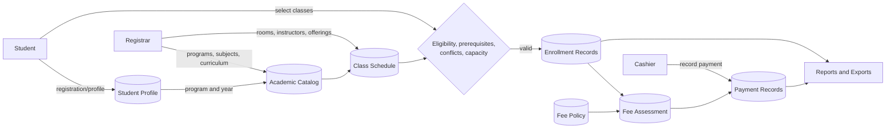
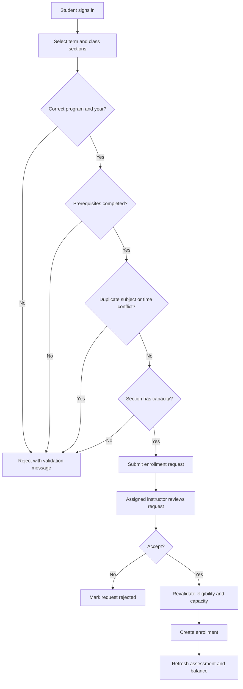

# Computerized Enrollment System

A Django-based enrollment application for student records, academic programs and
curricula, class scheduling, enrollment validation, fee assessment, payments,
role-specific access, and operational reports.

## Run locally

```powershell
python -m venv .venv
.\.venv\Scripts\Activate.ps1
python -m pip install -r requirements.txt
python manage.py migrate
python manage.py createsuperuser
python manage.py runserver
```

Open `http://127.0.0.1:8000/`. The first administrator is the Django
superuser. Use **Users** to create accounts and assign application roles.
Students can also register at `/accounts/register/`; registration requires
personal, contact, program, year-level, and account details.

## Mobile and installable app

The workspace navigation and dashboards adapt to phone screens, with a
horizontal, scrollable module bar so every role-available section stays
reachable. On supported mobile browsers, use the browser menu to install the
Enrollment System or add it to the home screen. The app caches its static
interface and shows an offline notice when disconnected; account pages and
student data are never cached and still require an internet connection.

## Functional requirements and implementation

1. **Student registration and records** — `StudentProfile` links a Django
   account to a generated unique `STU-<year>-<random>` student number, contact
   details, program, year level, and status. Students can update their own
   contact details. Registrars and administrators can register students and
   edit their academic and personal records. Open **Students → Student
   Directory** or **My profile**.
2. **Programs, subjects, and curriculum** — `Program` represents a course or
   degree program; `Subject` stores its code, description, and units;
   `CurriculumEntry` links a subject to a program and year level and records
   prerequisite subjects. Administrators and registrars can add, edit, and
   delete catalog records from **Academics → Programs, Subjects & Curriculum**.
3. **Enrollment processing** — Students submit requests for class offerings
   within their assigned program and year level at **Enrollments → Select
   classes**. The assigned instructor reviews and accepts or rejects each
   request. Acceptance revalidates curriculum eligibility, prerequisite
   completion, duplicate subjects, schedule conflicts, and seat capacity;
   approved requests create enrollment records and refresh the student's
   assessment.
4. **Assessment and payments** — An assessment is created/refreshed when a
   student enrolls. Tuition is enrolled units multiplied by the per-unit rate,
   plus registration and technology fees. The default policy is 1,000 per unit,
   500 registration, and 250 technology; administrators can edit the fee
   policy in Django admin. The assessment page shows each charge, total,
   payments, and balance. Cashiers record payments; the system rejects
   non-positive payments and amounts above the outstanding balance. No external
   payment gateway is connected. Students can print their balance list or
   download it as PDF or Excel from **Finance → Fee Assessments**; exported
   student reports contain only that student's records.
5. **Class scheduling** — `Room` and `ClassOffering` store rooms, sections,
   term, meeting days, start/end time, instructor, and capacity. Scheduling
   forms reject overlapping bookings for the same room or instructor on shared
   days. Students can browse offerings and enroll in an available section.
6. **Reports and exports** — The Reports module generates enrollment details
   (including program, year, subject, and term), enrollment totals per term,
   and assessed/collected/balance summaries. Reports can be filtered by term
   and downloaded as `.xlsx` or PDF.
7. **Accounts and roles** — Every account uses Django's unique username and
   password handling. Public registration creates a Student account only.
   Administrators can create, edit, activate/deactivate, assign roles, or
   remove accounts from **Users**. Access is enforced on server-side views:

   | Role | Access |
   |---|---|
   | Admin | All modules, all records, account/role management, Django admin |
   | Registrar | Student records, academic catalog, enrollment, schedules, enrollment reports |
   | Cashier | Assessments, payments, collection reports |
   | Instructor | Assigned classes and their enrollment rosters |
   | Student | Own profile, class offerings, own enrollments and assessments |

   Administrators assign roles; users cannot grant themselves privileges.
   Accounts created by the demo seeder have unusable passwords and cannot log
   in.

## In-app workflow notifications

The **Messages** inbox and unread counter provide in-app notifications (not
email or SMS). Creating an account notifies administrators. Submitting an
enrollment request notifies the assigned instructor. Accepting it notifies
registrars and cashiers that the assessment is ready. Recording a payment
notifies the student with the remaining balance.

## Forms and sample interfaces

The working forms are rendered from Django forms with CSRF protection and
server-side validation:

| Interface | Route |
|---|---|
| Student registration | `/accounts/register/` |
| Student profile | `/students/profile/` |
| Registrar student intake and editing | `/students/admissions/`, `/students/directory/` |
| Program, subject, prerequisite, and curriculum forms | `/academics/courses/` |
| Class and room forms | `/scheduling/classes/`, `/scheduling/rooms/` |
| Student subject selection | `/enrollments/select/` |
| Enrollment summary and roster | `/enrollments/records/` |
| Assessment slip and payment history | `/finance/invoices/` |
| Cashier payment entry | Assessment → **Record payment** |
| User/role management | `/students/users/` (Admin only) |
| Reports and exports | `/reports/` |

Data tables throughout the modules include table-wide search, sorting by
available columns (including names, dates, status, and amounts where present),
and pagination. Pagination starts at 10 rows and can be changed to 25 or 50.
The pages provide role-specific navigation; opening a restricted route directly
is also blocked by the server.

## Data flow



### Enrollment activity



## Demo data

After migrations, generate deterministic fictional data with Faker:

```powershell
python manage.py seed_demo_data --students 2 --seed 2026
```

To remove all existing records and rebuild a clean local test database, use:

```powershell
python manage.py seed_demo_data --reset --students 6 --seed 2026 --password "DemoPass123!"
```

The command is repeatable and creates demo programs, subjects, curriculum and
prerequisites, rooms, class offerings, two Registrar, two Cashier, two
Instructor, and the requested number of Student accounts, student profiles,
enrollments, assessments, and sample payments. Faker accounts use
`example.invalid` addresses and unusable passwords by default. The command
refuses to overwrite an account using the reserved demo usernames if it does
not have a demo address. With `--password`, it also creates the local-only
`demo.admin` superuser for role testing. Do not use that option with real or
deployed accounts.

See [TESTING.md](TESTING.md) for demo accounts, expected test scenarios, and
the end-to-end verification sequence.

## Verification

```powershell
python manage.py check
python manage.py test
```
